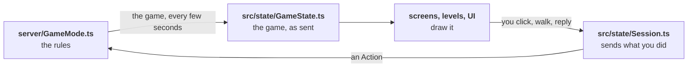

# Bringing your work into the new game

The game was refactored into one Vite + TypeScript app and a small Node server, in place of the separate `app/`, `frontend/`, `backend/` and `demo/` folders. Everyone's work is still in it, just organized differently. If you have work on the old layout (on `main` or your own branch), don't rebase onto this. Port it by hand, using the table below. Each kind of change has one place to go.

Read [AGENTS.md](AGENTS.md) first. It sets the shape of the code and what to update when you change something.

## Where your work goes now

| You worked on (old) | It lives in (new) | How to port it |
|---|---|---|
| **An event / surprise** (`events/*.csv`) | `jobs/<id>/job.json`, `"surprises"` | One object per row: `title` (the event), `description`, and `options` as `{ "text", "quality" }`, with quality `good`, `ok`, `wrong` or `excessive`. |
| **A new job** (`events/` CSV, `backend/src/content/projects.ts`, a spot in `frontend/`) | A new folder `jobs/<id>/` | Copy any job folder and change its `job.json`: title, `level` and `spot` (x, y, w, h in that level), `quote`, `steps`, `surprises`, `video`, `ask`. Then add a `backdrop.png` (480 × 270). To make it turn up later, add `"appears": { "day": 3, "from": "partner", "news": "…" }`. Run `npm run dev`. If anything's wrong, the server lists it and won't start. |
| **A tool** (`frontend/game/store.js`, `SHOP`) | `server/tools.json` | A cheap, a right and a premium option, each with a price and the clerk's `pitch`. A step names the tool it needs: `"tool": "stud-finder"`. |
| **A text, a line, a personality** (`frontend/game/core.js` `TEXTS`, `events/character-texts.txt`) | `server/roles.ts` | Each role's `who` (how they talk), `mood`, and `lines`. Claude writes the actual texts in that voice. |
| **A rule or a number** (`backend/src/engine`, `consequences.ts`, the balance) | `server/GameMode.ts` | Constants at the top, such as `OUTCOMES` (Ramy's numbers), `SURPRISE_CHANCE`, `RUSH` and `MATERIALS`. One class per game; anything that happens later goes on its timeline. |
| **A place you walk around** (`frontend/game/house.js`, `yard.js`) | `src/levels/<Level>.ts` and its art in `src/assets/art/levels/<level>/` | A level lists its actors (props, surfaces, doors) with x, y, w and h. Each has `<name>-day.png` and `<name>-night.png`. |
| **An intro or end screen** (`app/screens/`) | `src/screens/<Screen>.ts` | Listed in play order in `src/screens/index.ts`. |
| **The phone** (`frontend/game/phone.js`) | `src/ui/Phone.ts` | Messages, WeTube and AskBot are pages of the phone. |
| **Art, sound, music** (`assets/`) | `src/assets/art/…` and `src/assets/audio/…` | Imported where used (`import x from '@audio/…'`). A job's own pictures go in its folder. Icons are SVG files in `src/assets/art/icons/`; nothing is drawn in code. |
| **The look** (`assets/style.css`, `frontend/style.css`) | `src/style.css` | One stylesheet: shared tokens first, then a section per screen or widget. Two text sizes, UI text in CAPS, one gold hover. |
| **The API** (`backend/API.md`, `GameService`) | `server/routes.ts` and `shared/game.ts` | Three routes. The server sends the whole game every time (`GameView`), plus what just happened (`Happening`). The app sends `Action`s. |
| **The demo** (`demo/`) | Not ported | The hands-free demo was dropped. |

## How the pieces fit

The server owns every rule. The app only draws what it was sent, and reports what you did. If your change is a rule, it goes on the server; if it's how something looks, it goes in the app.

## Check your port

1. `npm install`, then `npm run dev`, and open http://localhost:5173. You need to be signed in to Claude: `brew install anthropics/tap/ant`, then `ant auth login`.
2. `npm run build` passes (it checks the types).
3. Play the part you ported.
