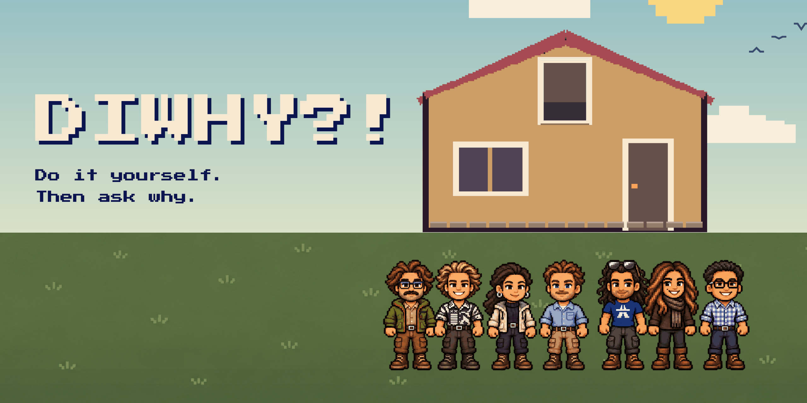

# DIWhy



**Do it yourself. Then ask why.**

A game where replacing one faucet snowballs into a very different project. You turn down the contractor's quote and do it yourself. Choices change a hidden state, the state decides which problems come next, and the end report counts the moments you asked "why?".

## For developers

### Run it

You need [Node.js](https://nodejs.org). From the top of the repo:

```sh
npm install   # once
npm start     # then open http://127.0.0.1:3001
npm test      # run the tests
```

To watch instead of play, press **watch the demo** at the top left of the character screen: the game plays itself, from the splash to the final report. How that works is in [`demo/`](demo/README.md).

### How it's organized

One small Node server runs everything: it serves the pages and runs the game rules. Each person works in their own folder:

- [`app/`](app/README.md): the intro, from the splash to SOLD! (HTML, CSS, JavaScript)
- [`frontend/`](frontend/README.md): the game itself: the yard, the house, the phone, the post-its (HTML, CSS, JavaScript)
- [`backend/`](backend/README.md): the game rules, the dice and the API (TypeScript on Node). [`API.md`](backend/API.md) if you're building a front end
- [`events/`](events/): the events, one CSV per job. Add a row and the next game uses it
- [`assets/`](assets/README.md): art, sound and brand (SVG, MP3)
- [`demo/`](demo/README.md): the hands-free playthrough
- [`plan/`](plan/): the plan: the game's story and flow ([`plan.md`](plan/plan.md)), and a review of the flow and its gaps
